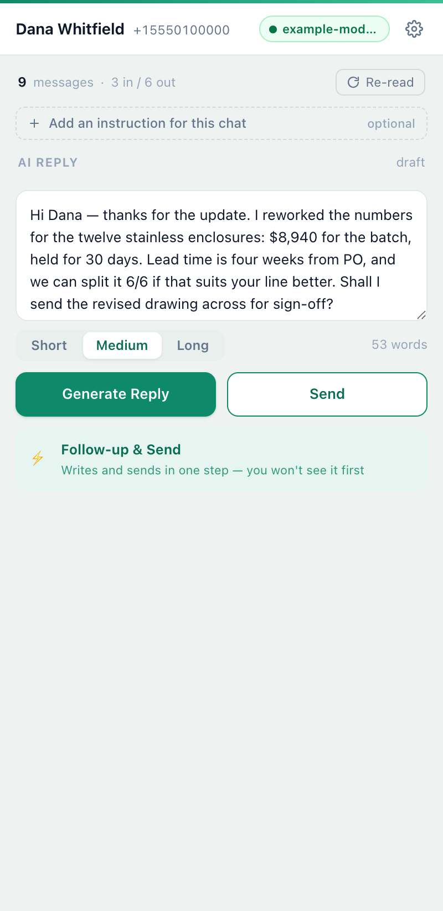
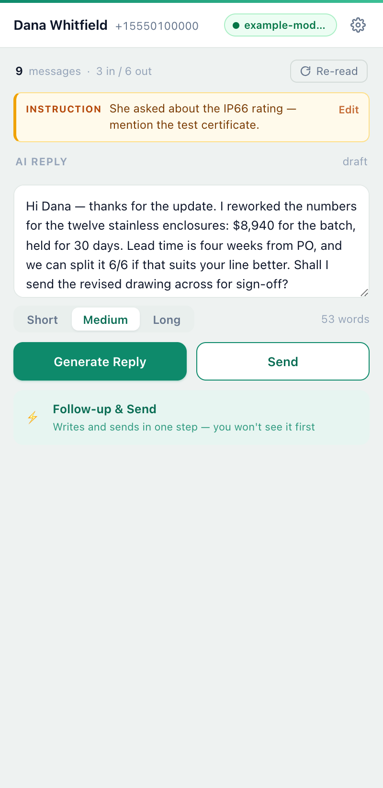
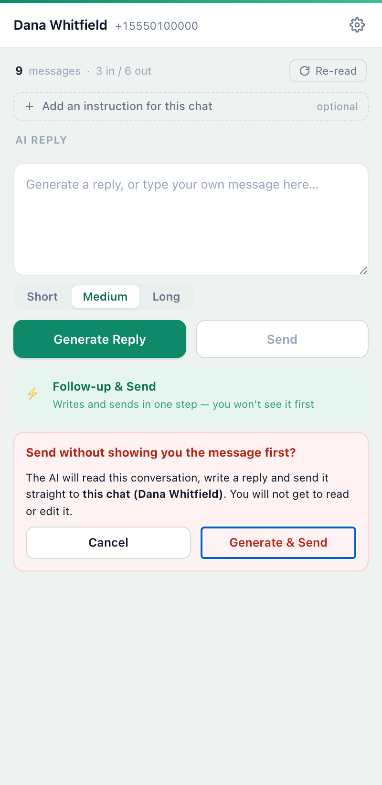
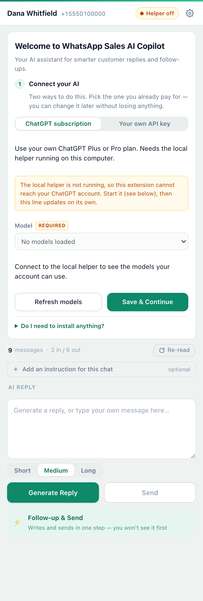
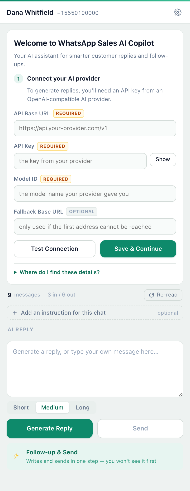

# WhatsApp Sales AI Copilot — Chrome Extension

**Stop rereading chats. Let AI handle the sales follow-up.**

An open-source Chrome extension that helps salespeople understand past WhatsApp conversations and generate relevant replies and follow-ups — without copying and pasting.

**[Download Extension](https://github.com/Employee-Zero/whatsapp-sales-ai-copilot/releases/latest)** · **[Installation Guide](docs/GETTING_STARTED.md)**

<table>
<tr>
<td align="center"> AI Replies</td>
<td align="center"> Custom Instructions</td>
<td align="center"> Follow-ups</td>
</tr>
</table>

*Real extension screenshots with fictional conversations. Click an image to enlarge.*

## Why We Built This

In B2B sales, customer conversations pile up quickly.

When you follow up weeks or months later, it's easy to forget what the customer needed, what you discussed, or where you left off.

AI made writing replies easier, but repeatedly copying WhatsApp conversations into AI tools was still slow and frustrating.

**That's why we built this extension — to bring AI directly into WhatsApp Web and eliminate the endless copy-paste.**

## What It Does

**1. Read Conversations in One Click**

Capture messages from your current WhatsApp Web conversation. Need more history? Simply scroll up to load older messages before generating a reply.

**2. Customize AI for Your Business**

Set your own AI prompt to match your industry, products, and sales style. Add specific instructions for individual customers.

**3. Generate Better Replies and Follow-ups**

Create natural, context-aware replies based on your conversations. Choose the length, edit the draft, and send when you're ready.

**Less reading. Less copying. More selling.**

## Two Ways to Connect Your AI

Pick whichever suits you. You can switch later without losing the other one's settings, your per-chat instructions, or your drafts.

<table>
<tr>
<td align="center" width="50%"> <b>ChatGPT subscription</b></td>
<td align="center" width="50%"> <b>Your own API key</b></td>
</tr>
</table>

### Sign in with ChatGPT

Use the ChatGPT plan you already pay for. You sign in to OpenAI in a normal browser tab, and this extension writes replies with the models your account can use.

**This method needs one extra step.** OpenAI's sign-in for open-source apps only accepts a callback to `127.0.0.1`, which a browser extension cannot provide. So Employee Zero ships **ChatGPT Connector for Sales AI Copilot**, a small background app for Apple Silicon Macs. It is made by Employee Zero and is not an OpenAI product. It completes the sign-in and is the only thing that holds your credential; the extension never sees a token.

In the extension, choose **ChatGPT** and follow the three steps (requires ChatGPT Plus or Pro):

1. **Install ChatGPT Connector** — click **Download for Mac** and open the `.pkg`. It is not signed with an Apple Developer ID or notarized, so macOS may ask you to allow it in System Settings › Privacy & Security.
2. **Allow Local Access** — lets Chrome reach the Connector on `127.0.0.1`.
3. **Connect with ChatGPT** — sign in to OpenAI in a normal browser tab, then pick a model.

Direct download: [ChatGPT-Connector-for-Sales-AI-Copilot-macOS-arm64.pkg](https://github.com/Employee-Zero/whatsapp-sales-ai-copilot/releases/latest/download/ChatGPT-Connector-for-Sales-AI-Copilot-macOS-arm64.pkg). Signing out from the extension revokes the credential and deletes it. Developers can still run the source with `node helper/siwc-helper.js` (Node.js 20+); see [helper/README.md](helper/README.md).

Two honest caveats. **Whether your plan is eligible is OpenAI's decision, not ours** — if your account cannot be used this way, the extension says so and the API-key method still works. And a plan is not unlimited: replies draw on the same allowance you use in ChatGPT itself, so heavy use will hit it.

### Your own API key

Connect any OpenAI-compatible provider: the Base URL of its `POST /chat/completions` endpoint, your API key, and the model name. Nothing to install, and you control which provider sees your conversations.

## Get Started

1. **Download** the latest release and unzip the extension ZIP. For the ChatGPT method you also install the Connector `.pkg` (the extension links to it).
2. **Install** the extension in Chrome: `chrome://extensions` → Developer mode → Load unpacked.
3. **Connect your AI**: sign in with ChatGPT, or enter your own API Base URL, API Key, and Model ID.
4. **Start replying** — open a WhatsApp conversation, generate a reply, review, and send.

**[Step-by-Step Installation Guide →](docs/GETTING_STARTED.md)**

## AI Setup & Cost

**The extension is free and open source. AI replies require either your own API key or an eligible ChatGPT plan.**

- **With your own API key**, your provider charges you for usage at its own rates.
- **With a ChatGPT plan**, replies count against your plan's allowance instead. This project cannot tell you whether your particular plan is eligible, what it costs, or how much allowance you have — only OpenAI can, and the sign-in is where you find out.

New to AI APIs? Our [Installation Guide](docs/GETTING_STARTED.md#option-b--use-your-own-api-key) explains how to get a key and set everything up.

*Note: these are two separate things. A ChatGPT subscription is not API credit, and an API key does not draw on your subscription.*

## Good to Know

- Chat messages are sent to the AI provider you chose when you generate a reply — your API provider, or OpenAI if you connected a ChatGPT plan.
- If you use the ChatGPT subscription method, your sign-in credential is stored by the local helper on your own computer, in a file only your user account can read. It is never put in browser storage, never logged, and never sent to WhatsApp.
- Only messages currently loaded in WhatsApp Web are available to the extension.
- No CRM integration, bulk messaging, or scheduled follow-ups.
- This is an independent open-source project, not affiliated with WhatsApp, Meta, or OpenAI.

[Privacy](PRIVACY.md) · [Security](SECURITY.md) · [For Developers](docs/DEVELOPMENT.md) · [Report an Issue](https://github.com/Employee-Zero/whatsapp-sales-ai-copilot/issues) · [MIT License](LICENSE)

**Employee Zero — Your first employee isn't human.**
