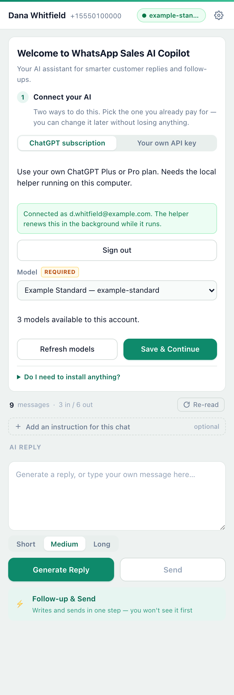
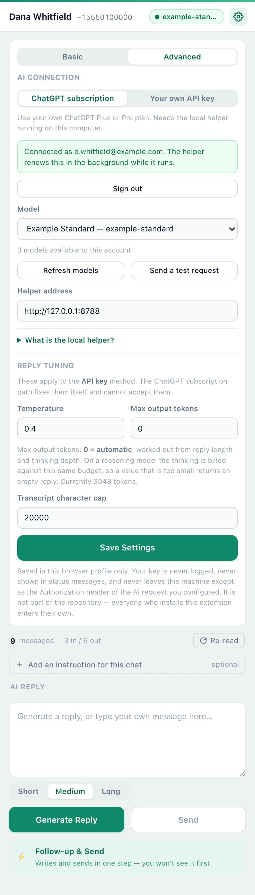

# Getting Started

Install **WhatsApp Sales AI Copilot** in four steps. No coding required.

**You'll need:** Google Chrome, WhatsApp Web, and one way to reach an AI —
either an API key from a provider, or a ChatGPT plan plus Node.js for the local
helper. Step 3 covers both.

## Step 1 — Download

1. Open the **[latest release](https://github.com/Employee-Zero/whatsapp-sales-ai-copilot/releases/latest)**.
2. Under **Assets**, download the extension ZIP file. That is
   `whatsapp-sales-ai-copilot-<version>.zip`. Do **not** download the files
   labeled "Source code".
3. Unzip the file and keep the extracted folder somewhere permanent, such as Documents.

*You do not need a GitHub account to download the extension.*

**Only if you plan to use the ChatGPT subscription method**, also download
`whatsapp-sales-ai-copilot-helper-<version>.zip` and unzip it **into the same
place as the extension folder**, so the two sit side by side:

```
whatsapp-sales-ai-copilot-0.2.0/       <- the extension folder
helper/                                <- the helper, from the second ZIP
```

If you are going to use your own API key, skip the second ZIP. You do not need
it and nothing will ask for it.

## Step 2 — Install in Chrome

1. Open Chrome and go to `chrome://extensions`.
2. Turn on **Developer mode** in the top-right corner.
3. Click **Load unpacked**.
4. Select the extracted folder containing `manifest.json`.

<a href="assets/00-chrome-extensions.png"></a>

The extension is now installed. You can pin its icon to the Chrome toolbar for easy access.

## Step 3 — Connect Your AI

Open [WhatsApp Web](https://web.whatsapp.com), then click the extension icon.
You will see two ways to connect. Pick one — you can switch later, and switching
does not lose the other one's settings or your drafts.

<table>
<tr>
<td align="center"><a href="assets/08-chatgpt-helper-off.png"></a><br><sub>ChatGPT subscription</sub></td>
<td align="center"><a href="assets/01-first-run-setup.png"></a><br><sub>Your own API key</sub></td>
</tr>
</table>

### Option A — Sign in with ChatGPT

Use the ChatGPT plan you already pay for.

**What you need:** Node.js 20 or later. Check with `node --version`. If the
command is not found, install it from [nodejs.org](https://nodejs.org) first —
nothing else needs installing, and the helper has no dependencies.

1. Open a terminal in the folder that contains `helper/` — the one from the
   second ZIP. On macOS you can right-click the folder in Finder and choose
   **New Terminal at Folder**.
2. Start the helper:

   ```
   node helper/siwc-helper.js
   ```

   It prints the address it is listening on and stays running. Leave it running
   while you use this method.
3. In the extension, choose **ChatGPT subscription** and click **Continue with
   ChatGPT**.
4. Chrome asks for permission to reach `127.0.0.1`. That is the helper on your
   own computer. Allow it.
5. A tab opens at OpenAI. Sign in, and accept the plan permissions when asked.
6. Come back to the extension. It notices on its own, usually within a second or
   two, and shows **Connected as _your address_**.
7. Pick a model from the list — those are the models your account can use — and
   click **Save & Continue**.

<a href="assets/09-chatgpt-connected.png"></a>

**Where your sign-in is kept.** Not in the browser. The helper keeps it in a
single file on your own computer — `~/.config/whatsapp-sales-ai-copilot/credentials.json`
on macOS and Linux, `%APPDATA%\whatsapp-sales-ai-copilot\credentials.json` on
Windows — readable only by your user account. The extension never receives a
token at all, and it has nowhere to put one. **Sign out** in the extension
revokes it at OpenAI and deletes the file.

**Cost:** replies count against your plan's allowance — the same allowance you
use in ChatGPT itself. It is not unlimited. Whether your plan can be used this
way at all is decided by OpenAI when you sign in; if your account is not
eligible, or has no allowance left, the extension tells you which of the two it
was, and the API key method below still works.

### Option B — Use Your Own API Key

Nothing to install. You need an API key from a provider.

**What is an API key?**

An API key is a private code that allows this extension to connect to an AI
provider. It's different from your ChatGPT login or subscription.

If you don't have one yet:

1. Choose an AI provider that supports an **OpenAI-compatible API**.
2. Create an API account and generate a key from the provider's dashboard.
3. Find the provider's **API Base URL** and **Model ID** in its documentation.

In the extension, choose **Your own API key** and enter:

- **API Base URL** — your provider's API address.
- **API Key** — your private API key.
- **Model ID** — the AI model you want to use.

Leave **Fallback Base URL** empty unless you need it. Click **Test Connection**,
then **Save & Continue**.

<table>
<tr>
<td align="center"><a href="assets/02-connect-your-ai.png"></a><br><sub>Test connection</sub></td>
<td align="center"><a href="assets/03-what-to-do-next.png"></a><br><sub>Continue</sub></td>
</tr>
</table>

**Cost:** The extension is free and open source. Your AI provider charges you for
usage at its own rates.

**Keep your API key private.** Do not share it with anyone.

### Changing your mind later

Open the extension's settings (the ⚙ button) and use the same two-way switch at
the top of **Advanced**. The other method's details are still there, your
per-chat instructions are untouched, and your drafts are untouched.

<a href="assets/10-settings-chatgpt.png"></a>

## Step 4 — Generate Your First Reply

1. Open a customer conversation in WhatsApp Web.
2. Click **Generate Reply**.
3. Review or edit the AI-generated message.
4. Click **Send**.

<table>
<tr>
<td align="center"><a href="assets/04-generated-draft.png"></a><br><sub>Generate and edit</sub></td>
<td align="center"><a href="assets/05-per-chat-instruction.png"></a><br><sub>Optional chat instructions</sub></td>
</tr>
</table>

You can also choose Short, Medium, or Long replies and add instructions for individual customers.

## Need Help?

**Can't find Load unpacked?** Enable Developer mode first.

**Extension won't load?** Select the folder containing `manifest.json`, not the ZIP file.

**"The local helper is not running."** The helper is not started, or it is on a
different port from the one in the settings. Run `node helper/siwc-helper.js`
from the folder that contains `helper/`, and check the **Helper address** field
matches the port it printed.

**"Port 8788 is already in use."** Another copy of the helper is probably
already running. That is usually fine. If not, start it with
`node helper/siwc-helper.js --port 8789` and set **Helper address** to
`http://127.0.0.1:8789`.

**Sign-in finished but replies still fail.** Run
`node helper/siwc-helper.js --status` and look at whether plan usage is allowed.
If it is not, click **Sign out** and sign in again, accepting the plan
permissions when asked.

**"No plan access" or an allowance message.** That comes from OpenAI, not from
this extension, and it cannot be worked around here. Switch to **Your own API
key**, which always works.

**AI connection failed (API key method).** Check your API Base URL, API Key, Model ID, and provider account.

**Stopping the helper.** Press Ctrl+C in the terminal it is running in. The
extension will say the helper is off until you start it again.

**Updating the extension?** Download the latest ZIP, replace the files in the same folder, and click Reload on `chrome://extensions`. Refresh WhatsApp Web afterward. If you updated the helper too, stop it and start it again.

For privacy details, see [PRIVACY.md](../PRIVACY.md). For what the helper does
and does not do, see [helper/README.md](../helper/README.md).

*Screenshots show fictional demo data. When you generate a reply, your chat text is sent to the AI provider you selected.*

[← Back to project home](../README.md)
