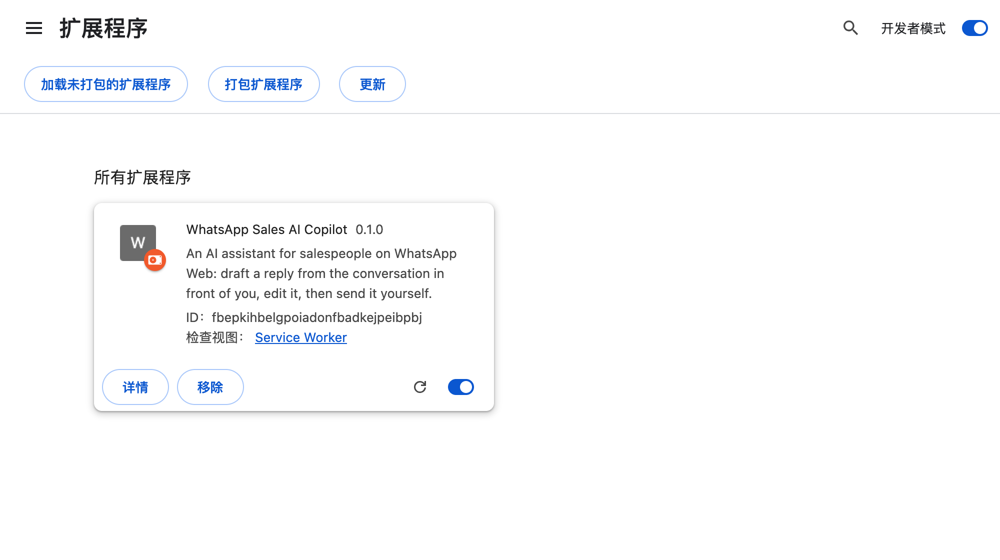
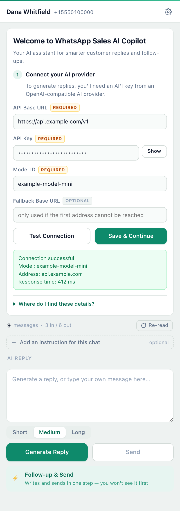
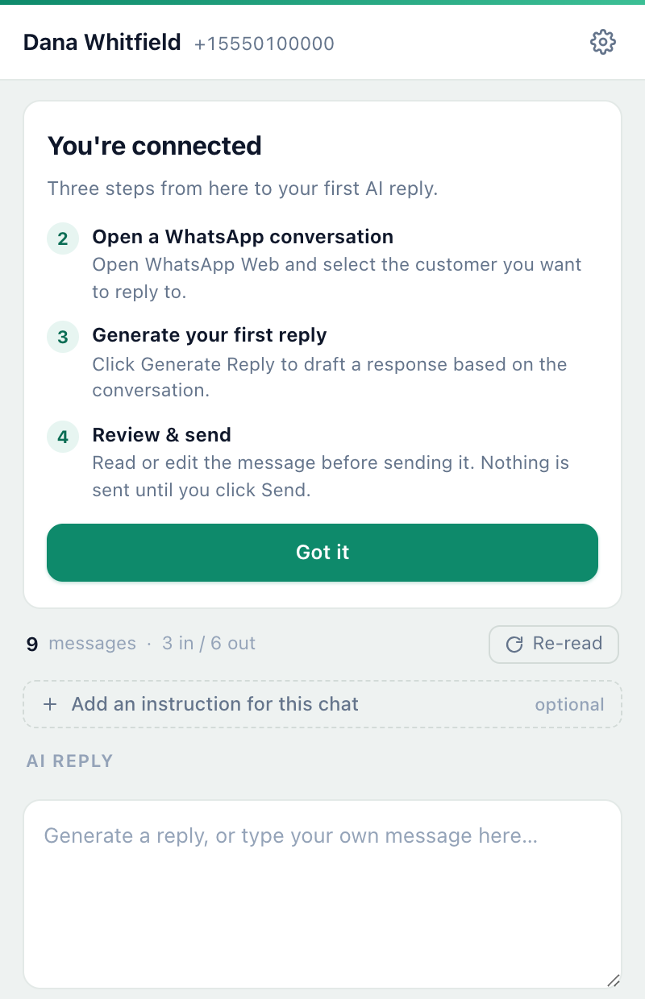

# Getting started

A step-by-step install guide for **WhatsApp Sales AI Copilot**, written for
people who have never used a Terminal, GitHub, or Node.js. If you can install a
program and follow six clicks, you can do this.

Total time: about ten minutes, most of which is signing up with an AI provider.

**Contents**

1. [Before you start](#1-before-you-start)
2. [Download it](#2-download-it)
3. [Unzip it — and keep the folder](#3-unzip-it--and-keep-the-folder)
4. [Load it into Chrome](#4-load-it-into-chrome)
5. [About the warning Chrome shows you](#5-about-the-warning-chrome-shows-you)
6. [Pin it where you can find it](#6-pin-it-where-you-can-find-it)
7. [Connect your AI provider](#7-connect-your-ai-provider)
8. [Your first reply](#8-your-first-reply)
9. [Updating to a new version](#9-updating-to-a-new-version)
10. [If something goes wrong](#10-if-something-goes-wrong)
11. [Uninstalling](#11-uninstalling)

---

## 1. Before you start

You need three things:

| | |
|---|---|
| **Google Chrome** | The browser. If you're reading this in Chrome, you have it. |
| **WhatsApp Web** | Already signed in on this computer. Open [web.whatsapp.com](https://web.whatsapp.com) and check you can see your chats. |
| **An AI provider account** | This is the one part that costs money. You'll need an API key. See [step 7](#7-connect-your-ai-provider). |

You do **not** need: Node.js, Git, a Terminal, a server, or an account with us.

> **A note about "Developer mode".** Installing this extension means turning on a
> Chrome setting called Developer mode. It sounds more serious than it is — it
> just tells Chrome "let me install things that didn't come from the Web Store".
> You can leave it on. It doesn't change how Chrome behaves otherwise.

---

## 2. Download it

Go to the **[Releases page](https://github.com/Employee-Zero/whatsapp-sales-ai-copilot/releases/latest)**
and find the newest release at the top. Under **Assets**, click the file ending
in **`.zip`**.



*You'll see this page again in step 4 — the extension listed there, already working.*

*Every screenshot in this guide is a demonstration with invented details: a
fictional contact, a fictional company and a reserved `555` phone number. No real
customer's conversation appears in any of them — the README explains how they are
produced.*

Your browser will download the ZIP to your Downloads folder.

---

## 3. Unzip it — and keep the folder

Find the ZIP in your Downloads folder and **double-click it** (Windows: right-click
→ *Extract All*). You'll get a folder named something like
`whatsapp-sales-ai-copilot-0.1.0`.

**Move that folder somewhere permanent before you go on.** Your Documents folder
is a good place. Desktop is fine too.

> ### This part matters
>
> Chrome does not copy the extension anywhere. It reads it from that folder
> **every time Chrome starts**. So:
>
> - **Don't delete the folder** after installing.
> - **Don't move it** to a different place later — if you do, the extension
>   disappears and you'll need to load it again (step 4).
> - **Don't put it in Downloads** if you regularly empty Downloads.
>
> If you already have an older version installed, you can replace the contents of
> the folder with the new version — see [step 9](#9-updating-to-a-new-version).
> Your settings and API key are kept either way.

---

## 4. Load it into Chrome

1. Open a new tab and type this into the address bar, then press Enter:

   ```
   chrome://extensions
   ```

2. In the **top-right corner** of that page there's a switch called
   **Developer mode**. Turn it **on**.

   The page changes: a toolbar appears at the top with *Load unpacked*, *Pack
   extension*, and *Update*.

3. Click **Load unpacked**.

4. A file browser opens. Navigate to the folder from step 3 — the one containing
   a file called `manifest.json` — and select the **folder itself** (not a file
   inside it). Click **Select** / **Open**.

5. The extension appears on the page as a card: **WhatsApp Sales AI Copilot**,
   version `0.1.0`, with a blue toggle switched on.

You're done installing. Chrome will now offer you a warning — read the next
section before you dismiss it.

---

## 5. About the warning Chrome shows you

Chrome may show a popup or a yellow banner saying something like
*"Disable developer mode extensions"*, and the extension's card may carry a
warning triangle.

**This is expected, and here is exactly what it means.**

Chrome shows that warning for **every extension that wasn't installed from the
Chrome Web Store**. It is not a virus scan result. Chrome has not inspected this
code and found a problem — Chrome simply can't vouch for extensions it hasn't
reviewed, so it tells you so and lets you decide.

What that means for you in practice:

- **Chrome will nag you about it occasionally**, especially at startup. Click
  *Keep* / *Cancel* on the popup — never *Disable* — and it will leave you alone
  for a while.
- **Chrome will not update it for you.** Extensions from the Web Store update
  silently; this one can't. See [step 9](#9-updating-to-a-new-version).
- **You should satisfy yourself that you trust the source.** That's true of any
  software you install outside a store. The code is public and readable, and
  [PRIVACY.md](../PRIVACY.md) explains exactly what it reads and where it sends
  it.

If a button offers to *Disable* or *Remove* the extension, don't click it —
that's Chrome asking whether you want to undo step 4, not warning you about
anything it found.

---

## 6. Pin it where you can find it

The extension doesn't do anything until you open its panel, so make it one click
away:

1. Look at the top-right of Chrome, next to your profile picture. Click the
   **puzzle-piece icon** (Extensions).
2. Find **WhatsApp Sales AI Copilot** in the list and click the **pin** icon next
   to it.
3. The extension's icon now sits in your toolbar.

---

## 7. Connect your AI provider

This is the only real setup, and you only do it once.

### Get an API key

You need an account with a company that provides AI models, and an API key from
them. Any provider offering an **OpenAI-compatible API** works — that's most of
them, including OpenAI, OpenRouter, Together, DeepSeek, Groq, and self-hosted
setups like Ollama.

Sign up with whichever you prefer, add a small amount of credit if they ask for
it, and find the page called **API keys** (sometimes under *Dashboard* or
*Settings*). Create a key and copy it. Treat it like a password — it's billed to
your account.

While you're there, note down two more things from their documentation:

- the **Base URL** — looks like `https://api.provider.com/v1`
- the **model name** you want to use — looks like `gpt-4o-mini`

> **Which model?** A small, fast model is the right choice to start with. Sales
> replies don't need the most expensive model, and the cheap ones are usually
> indistinguishable for this job. You can change it any time.

### Enter them in the panel

1. Open [web.whatsapp.com](https://web.whatsapp.com) in Chrome.
2. Click the extension's icon in your toolbar. The side panel opens on the right
   of the window.

If this is the first time, the panel shows a welcome screen:


3. Fill in the three fields marked **Required**:

   | Field | What goes in it |
   |---|---|
   | **API Base URL** | The provider's address, e.g. `https://api.provider.com/v1` |
   | **API Key** | The key you copied. Paste it exactly — with or without an `sk-` at the front, both are fine. |
   | **Model ID** | The model name, exactly as the provider writes it |

   **Fallback Base URL** is optional. Leave it empty unless you have a second
   provider you want it to try if the first one is unreachable.

4. Click **Test Connection**. It sends one tiny request so you find out now
   rather than mid-conversation. You'll get either a green confirmation with the
   model name and response time, or a specific error telling you which field is
   wrong.

   

5. Click **Save & Continue**.

The panel then shows you the three things left to do — and after that, the
welcome screen never comes back:



> **Where do I find these details?** is a fold-out at the bottom of the setup
> screen with the same instructions as above, in case you're reading this in
> another window.
>
> **Changed your mind later?** Click the **gear icon** at the top of the panel at
> any time to reopen these settings.

---

## 8. Your first reply

1. Open WhatsApp Web and **click on a customer's conversation**.
2. Click the extension icon. The panel picks up the conversation you're looking
   at — you'll see their name at the top and a count of the messages it can read.
3. Click **Generate Reply**. A draft appears in the lower box.

   

4. **Read it and change anything you don't like.** It's a normal text box —
   click in it and type.
5. Click **Send**.

That's the whole loop. Everything else is refinement:

- **Short / Medium / Long** under the draft box changes how long the reply is.
- **Add an instruction for this chat** applies only to the customer you're
  looking at — "ask how the installation went", "she wants the IP66 certificate".
- The **gear icon** holds the prompt that tells the AI how your company writes.
  It's worth ten minutes of your time; see the README.

---

## 9. Updating to a new version

Chrome won't do this for you.

1. Go to the [Releases page](https://github.com/Employee-Zero/whatsapp-sales-ai-copilot/releases/latest)
   and download the new ZIP.
2. Unzip it.
3. **Replace the contents of your existing folder** with the new files — or
   delete the old folder and put the new one in the same place, then follow
   step 4 below if the extension shows as broken.
4. Go to `chrome://extensions` and click the **circular arrow** (↻) on the
   extension's card. Chrome reloads it from the folder.
5. Refresh your WhatsApp Web tab.

Your API key, prompt and settings are stored by Chrome, not in that folder, so
they survive the update.

---

## 10. If something goes wrong

**I don't see the "Load unpacked" button.**
Developer mode isn't on. It's the switch in the top-right of `chrome://extensions`.

**Chrome says "Manifest file is missing or unreadable".**
You selected a file or a parent folder instead of the folder that contains
`manifest.json`. Look inside the unzipped folder — if you see another folder with
the same name, go one level deeper.

**The extension disappeared after I restarted Chrome.**
The folder was moved, renamed or deleted. Chrome reads the extension from it on
every start. Put it back and load it again (step 4).

**The panel says "Fill in API Base URL, API Key first".**
Setup isn't finished. Click the gear icon and complete it.

**"Authentication failed" when I test the connection.**
Usually the provider account, not the key: no credit, or the key was deleted.
Check the provider's dashboard.

**"API endpoint invalid".**
The Base URL is wrong. It should end in `/v1` and should **not** include
`/chat/completions`.

**A new reply comes back empty.**
Open the settings and set **Max output tokens** back to `0` (automatic). See the
Troubleshooting section of the [README](../README.md#10-when-something-goes-wrong).

---

## 11. Uninstalling

Go to `chrome://extensions`, find the extension, click **Remove**.

That deletes everything it stored — your API key, your prompt, your drafts. Then
you can delete the folder.

Removing the extension does **not** touch WhatsApp itself, your chats, or your
WhatsApp login. Those live in WhatsApp Web and are unaffected.
